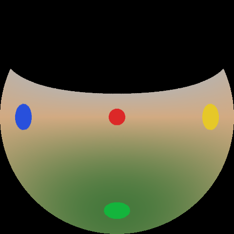
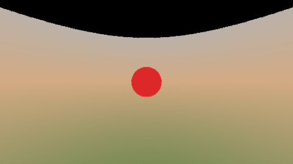
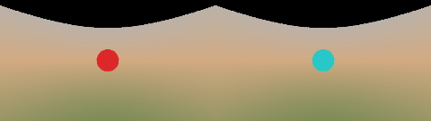
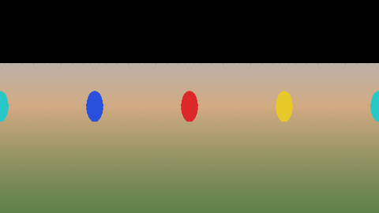
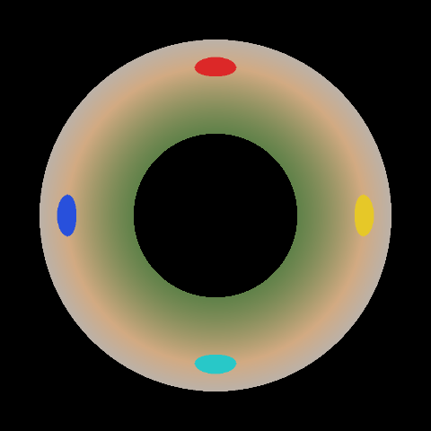
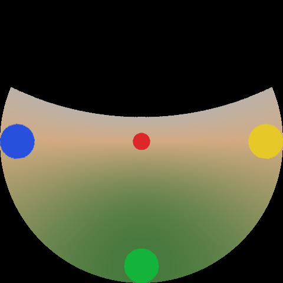
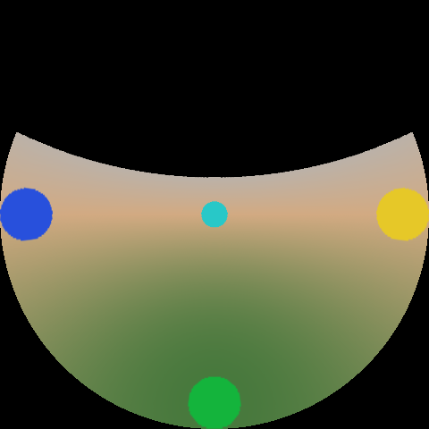

# ThreeSixtyView

Native macOS player for circular-fisheye video from mid-2010s consumer 360 cameras. It replaces the Kodak PixPro SP360 4K desktop app (and the Wideshoot rebrand of that app) for single-fisheye clips: the vendor software does not run on Apple Silicon, and this one does. Open the MP4 or still, look around, and export a flat video or a YouTube-ready equirectangular file. No ffmpeg.

## Requirements

- macOS 14 or later
- Apple Silicon
- Command Line Tools (`xcode-select --install`). Full Xcode is not required.

## Screenshot

A capture of the window goes in `docs/screenshots/window.png`.


The clips this was tuned for are H.264 1072×1072 at 29.97 fps, with AAC 48 kHz stereo, from the Fun Media Solutions *Guide logiciel 360 WIDESHOOT*. Each frame is one circular fisheye of about 225° that fills the square, shot from a roof mount with the lens pointing down. A square frame is detected as that fisheye, mount **Ceiling / down**, and the picture opens looking forward. A 2:1 frame is detected as equirectangular. Dual fisheye (one side-by-side frame, or a second file for the back lens) is in the inspector.

## What you can do

Playback matches the PIXPRO SP360 desktop software's Playback & Edit screen, plus the Wideshoot "record while you look around" export.

- **Open** a video or still with File → Open, File → Open Folder (the old "DISK" library), drag and drop, or by opening the file from Finder. Square clips are a 225° fisheye.
- **Presets:** a row of live thumbnails — Front, Rear, Left, Right, Sky, Tiny Planet, Panorama 360, Split, Ring. Tap one and the view eases there.
- **Transport:** play, pause, first and last frame, frame step, a slim scrubber, in and out marks. The glass controls fade while you watch.
- **Look around:** drag to look, with a short inertia after you let go. In Front the picture sticks to the pointer. In 360, Panorama, Ring, Dome, and Tiny Planet the same drag pans yaw (it wraps) and pitch, and so do the compass and the arrow keys. Scroll or pinch to zoom. Double-click resets. The opening rectilinear field of view is about 100°.
- **View mode:** Front, Dome, 360, Ring, and Planet sit in a segmented control. Every SP360 unfold is still in the adjustments panel and the Unfold menu: Original, Dome, Fisheye, Front 16:9, Front 4:3, Seg, Quad, Panorama, Ring, Magic Flat, Global, Little Planet, Equirect, Extraction, Throw-out.
- **Mount:** Ceiling / down (the roof mount), lens up, lens forward, LCD up, LCD down. **Video rotation** is 0° / 90° / 180° / 270° when the nose of the car is not toward the top of the circle. Open Adjustments (the sliders button) for lens FOV, center, calibration, grade, and the library.
- **Picture:** brightness, contrast, saturation, and a mild unsharp mask that is on until you turn it off. Sampling is Catmull-Rom, on screen and in exports, into an sRGB drawable at the screen’s Retina scale.
- **Still:** PNG or JPEG of the current unfold at the chosen size.
- **Export view:** H.264 or HEVC MP4 of the current angle for the whole clip or the in/out range, with audio.
- **Record view path:** play, look around (you can pause and change unfold mode), stop, and the path is rendered into the MP4. Same idea as the old Record / video-cutting flow.
- **YouTube / VR:** equirectangular MP4 (3840×1920, 2880×1440, or 1920×960) with Google Spatial Media v1 `uuid` metadata and an `sv3d` equirectangular projection box.
- **Trim original** (passthrough, so the cut lands on keyframes) and **join clips**. **Stills to video** turns the open folder's photos into a movie through the current unfold.

Wi-Fi remote control and signing into YouTube are not included. The camera is gone; the files are on disk. Upload the equirect MP4 yourself.

The picture is full-bleed. A glass capsule at the top shows the file name, resolution, frame rate, duration, codec, mount, yaw, pitch, and the active zoom. Export is a sheet (still, current view, YouTube 360, view path, trim, join). The same numbers can be edited from Adjustments.

## Build

Command Line Tools are enough. The package tools version is 5.9, so a current Swift release builds it in Swift 5 language mode. There are no package dependencies and nothing to fetch. GitHub Actions runs the same `swift build` and `swift run ThreeSixtyView --self-test` on `macos-latest`.

```bash
xcode-select --install   # once, if swift is not already on PATH
swift --version          # Apple Swift 6.4, target arm64-apple-macosx26
cd /path/to/ThreeSixtyView
swift build
swift run ThreeSixtyView --self-test
swift run ThreeSixtyView
```

Do not use `swift test` with Command Line Tools only. That SDK does not ship XCTest, and SwiftUI property-wrapper macros such as `@State` are not in the Command Line Tools either. The window is AppKit. `--self-test` runs the projection checks, the MP4 metadata checks, and a lint of the Metal source (no `hypot`, no variable named `half`). On macOS it also compiles that shader, then runs the AVFoundation/Metal export round trip (synthetic fisheye, flat MP4, equirect with spherical metadata, JPEG still, Metal versus CPU, HEVC when the encoder exists).

Release binary, still without Xcode:

```bash
swift build -c release
.build/release/ThreeSixtyView
```

### App bundle without Xcode

`Scripts/make-app-bundle.sh` runs `swift build -c release` and wraps the binary in `dist/ThreeSixtyView.app` with an `Info.plist` (`CFBundleIconFile` is `AppIcon`). It does not call `xcodebuild`. On an Apple Silicon Mac the universal (arm64 + x86_64) attempt needs a second SDK; if that is missing the script builds arm64 only.

`Scripts/make-icns.sh` rebuilds `Resources/AppIcon.icns` from `Resources/AppIcon.png` with `sips` and `iconutil` (16 through 1024, at 1x and @2x). The bundle script copies that icns into `Contents/Resources`.

```bash
chmod +x Scripts/make-app-bundle.sh
./Scripts/make-app-bundle.sh
open dist/ThreeSixtyView.app
```

The same layout by hand:

```bash
swift build -c release
APP=dist/ThreeSixtyView.app
rm -rf "$APP"
mkdir -p "$APP/Contents/MacOS"
cp "$(swift build -c release --show-bin-path)/ThreeSixtyView" "$APP/Contents/MacOS/ThreeSixtyView"
# Info.plist is written by Scripts/make-app-bundle.sh
open "$APP"
```

There is no `.xcodeproj`. `Package.swift` is the project. Xcode can open it if you install Xcode later; Command Line Tools never need that.

## Opening an SP360 clip

1. Copy the MP4 off the card (`DCIM/…/112_0006.MP4` in the Wideshoot guide). Playing from the card is unnecessarily slow.
2. File → Open, or double-click the MP4 if the app is the viewer for it. A square frame such as 1072×1072 is a single 225° fisheye, **Ceiling / down**, Front 16:9, yaw and pitch at zero so you are looking forward instead of at the roof. The field of view starts near 100° so the low-resolution circle is not cropped tight.
3. If the horizon is wrong, change **Mount**. If the street ahead is not forward, use **Video rotation**.
4. Turn on **Calibration circle** if the round image is not centered, then drag and scroll until the red ring sits on the fisheye edge.
5. Pick an unfold mode. Front 16:9 and Seg are the rectilinear "looks like a normal video" views. Dome, Fisheye, Global, and Little Planet are round. Panorama, Ring, and Magic Flat are the wide unfolds.

A 2:1 frame is treated as equirectangular. A 16:9 or 4:3 frame is treated as an ordinary flat video (SP360 Front mode cannot be unfolded). You can override the input projection in the inspector.

Dual-camera rigs: choose **Dual fisheye (side by side)** for one frame with two circles, or **Add Back Lens…** and **Dual fisheye (two files)** for a second still. Each lens is 225° by default, the back lens is yawed 180°, and the overlap is blended. Audio is copied as-is, so the 48 kHz stereo AAC track stays stereo. Frame step and export use 1001/30000 for 29.97 fps.

## Export

| Button | Result |
| --- | --- |
| Save Still | PNG or JPEG of the current unfold |
| Export View | Flat MP4, locked to the current aim, full clip or in/out |
| Record view path | MP4 of the aim you used while it was recording |
| YouTube / VR equirect | 2:1 MP4 with spherical metadata. Current yaw, pitch, and roll orient the sphere; Center first if you want the default front |
| Trim original | Passthrough copy of the in/out range of the source file |
| Join clips | Concatenate movies that share recording settings |
| Stills to video | Two seconds per photo in the library, through the current unfold |

The export sheet offers Original (the source's long side), 1080p, 1440p, 4K UHD (3840×2160, fit to the unfold), and 4K 360 (3840×1920). A square unfold stays square inside the 16:9 box, so a dome does not become an ellipse. HEVC is selected when you pick a 4K size; H.264 stays the default below that. **Full quality** in the viewer draws at the window's Retina size with the same Catmull-Rom sampling. A 1072×1072 source is upscaled for both, and the window says so. Audio is copied when the source has a track. Cancel leaves no finished file.

Bitrates default to about 0.18 bits per pixel per frame for H.264 and 0.10 for HEVC at 30 fps, with a 1 Mbps floor.

## Projection previews

These are renders of a synthetic ceiling-mounted 225° fisheye, not a photograph. Red is forward, yellow is right, blue is left, green is the ground under the camera. The lens points down, so the ground is the middle of the raw circle. Front 16:9 opens on the red marker, level with the horizon. Black above that horizon is sky the 225° lens never saw.










A desktop screenshot of the window belongs in `docs/screenshots/` once you have the app running (`docs/screenshots/window.png`). The picture fills the window. Preset cards and the transport sit on glass along the bottom; file info is a capsule at the top left.

The synthetic fisheye itself is `docs/synthetic-fisheye.png` (also `Fixtures/synthetic-fisheye.png`).

## Tests

Checks live in the libraries (`ProjectionChecks`, `SpatialChecks`, and on macOS `MacRoundTrip`) and run with:

```bash
swift run ThreeSixtyView --self-test
```

That covers unfold math, fisheye mounts, dual-lens blend, the 1072×1072 ceiling-down detection, the 100° default field of view, PNG round trip, a source lint of the Metal shader, MP4 spherical metadata (including chunk offsets when `moov` precedes `mdat`), and on macOS a real `makeLibrary` compile of that shader plus the encode/export/Metal comparison. There is no XCTest target, so Command Line Tools can build and run the suite.

## Layout

```
Sources/ProjectionMath/    unfold math, CPU rasterizer, PNG
Sources/SpatialMedia/      Spatial Media v1 uuid + sv3d injector
Sources/ThreeSixtyEngine/  Metal shader, AVFoundation export
Sources/ThreeSixtyView/    AppKit app
```

The Metal shader is the same model as `Projection.swift`: equidistant fisheye in, and the unfold modes above out. Directions the lens never saw stay black.

## License

MIT. Copyright 2026 Djamel Bendaoud. See [LICENSE](LICENSE).
